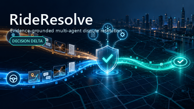

# RideResolve



RideResolve is an evidence-grounded dispute-resolution prototype with one official-case Intake and five Agents: Evidence Collection, Rider Advocate, Driver Advocate, Policy & Precedent, and Judge. The public v0.6 input is a normal problem description containing an official case or trip reference, never a user-supplied `run_id`. Intake resolves the explicit reference against official data and creates a signed internal run context. Explicit ADP workflow nodes then perform every role-scoped tool call; all five Agents are tool-free and run strictly in sequence. The Advocates independently inspect role-specific evidence results, reviewer-approved corrections are supplied as advisory precedent, and deterministic Python code exclusively controls policy applicability, case status, fee item, escalation, and simulated refund amount.

## Why this prototype is different

The core demo is **Decision Delta**: with the policy and every other business input fixed, the UI shows exactly how one late-arriving authoritative GPS record changes:

`evidence -> verifiable fact -> matched rule -> allowed action -> simulated money`

The system refuses to make that claim if the evidence entity is missing, its checksum or lineage fails, the evaluation came from different inputs, or the Judge conflicts with the program result.

## Current product surface

The English Streamlit page includes all nine demo sections from the v1.5 implementation plan:

1. case and version selection;
2. evidence summary and provenance inspection;
3. independent Rider/Driver queries and arguments;
4. Judge recommendation;
5. deterministic hard gates;
6. simulated status, action, money, and separated confidence signals;
7. separate party explanations;
8. Agent/tool timeline with an execution-mode label;
9. Decision Delta.

The Advocate section also exposes two MVP context sources that were previously missing:

- structured chat signals for sentiment, consent, disagreement, and threat, explicitly labelled as synthetic model-style interpretations;
- synthetic historical behavior profiles, marked `SUPPORTING` and `CONTEXT ONLY`.

Neither source can set credibility, liability, policy, status, or money. A regression test removes the historical profile and verifies that the matched rule and action remain unchanged.

## Implemented stretch goals

Four official bonus capabilities are implemented in the local synthetic demo:

1. **Evidence Collection Agent** - validates the version-pinned snapshot, evidence, and policy results supplied by fixed workflow tool nodes, packages the relevant records, verifies record checksums, and reports missing or incomplete inputs before the Advocates run. It cannot call tools or decide liability, status, action, or money.
2. **Policy & Precedent Agent** - validates workflow-supplied current policy and checksum-valid, reviewer-approved historical corrections, then supplies cited advisory context to the Judge. It cannot call tools, copy a historical outcome, or override current policy.
3. **Learning Feedback Loop** - accepts only genuine human overrides with evidence citations, a correction reason, a changed outcome, and `ADVISORY_PRECEDENT_ONLY` approval before publishing them to the append-only precedent memory.
4. **Escalation Protocol** - produces a complete human-review packet when a deterministic gate blocks the case or Judge self-confidence is below `70/100`. Confidence may trigger a safe escalation but can never authorize release or bypass a hard gate.

The accuracy-first prompt contracts and machine-readable graph are included for reproducibility. A functional v0.5 ADP run completed deterministic validation for official sample `DISP-001` in 48.183 seconds with 26,355 tokens. The local v0.6 update adds guarded natural-language intake, signed run contexts, expiry-bounded static connector credentials, and a WorkBuddy MCP adapter. v0.6 is locally verified but still requires CloudBase deployment, ADP import, publication, and a real AppKey smoke test.

The current local page is explicitly labelled **SYNTHETIC · OFFLINE DEMO**. It does not present fixture text as a live or replayed model run. `RESOLVED` is displayed as **Simulated resolution complete**, together with: “No real refund or user notification was executed.”

## Run the demo

From this directory, using Python 3.11 or later:

```powershell
python -m pip install -e .
python -m streamlit run app.py
```

Then open `http://localhost:8501`.

The default scenario is the persisted Decision Delta pair:

- `CASE-RD-001 v1`: 70% GPS coverage -> `RD-001` -> `PENDING_HUMAN_REVIEW`;
- `CASE-RD-001 v2`: one authoritative GPS supplement -> 100% coverage -> `RD-004` -> simulated SGD 3.25 refund.

The page also exposes a No-Show scenario and the stable Route Deviation case used for the ADP functional run.

## Synthetic data sources

The checked-in dataset contains 16 independent synthetic cases (8 Route Deviation and 8 No-Show), 79 integrity-checked evidence records, and at least one evaluated case for every one of the 13 policy rules. The approved precedent memory contains four checksum-bound synthetic records, including two comparable `RD-004` records, No-Show coverage, and one deliberately policy-conflicting historical outcome that remains advisory only.

Regenerate these auditable sources instead of editing their JSON by hand:

```powershell
python -m scripts.build_tool_cases
python -m scripts.build_approved_precedents
```

## Architecture

```text
External problem description (SYS.UserQuery)
                  |
                  v
Official reference resolver -- vague/ambiguous --> NEEDS_CLARIFICATION
                  |
                  v
Signed internal run context
                  |
                  v
Evidence Collector -> Rider Advocate -> Driver Advocate
                  -> Policy & Precedent -> deterministic evaluation
                  -> Judge explanations -> server-side validation
                  |
                  v
One End node: validated result, clarification, or technical failure
```

The preserved cloud evidence includes the historical three-core-Agent Route Deviation run, the five-Agent workflow-first No-Show run, and the validated v0.5 accuracy-first `DISP-001` result. The v0.6 deployment source of truth is [`accuracy_first_manifest.json`](docs/adp/accuracy_first_manifest.json), with operator steps in [`ACCURACY_FIRST_DEPLOYMENT.md`](docs/adp/ACCURACY_FIRST_DEPLOYMENT.md) and WorkBuddy handoff in [`WORKBUDDY_INTEGRATION.md`](docs/WORKBUDDY_INTEGRATION.md). Formal Gate A remains pending until the v0.6 service and workflow are deployed and their complete native traces are preserved and verified.

`docs/adp/multiagent_manifest.json` is an unvalidated historical experiment in Agent-owned tools, not the submission architecture. The root `RideResolve-Orchestration-import.zip` is a legacy three-Agent snapshot and must not be imported or uploaded as the current application.

## Verification

```powershell
python -m unittest discover -s tests -v
python -m pytest -q
python -m compileall -q app.py rideresolve scripts tests
```

The suite covers persisted Delta data, official-over-mock precedence, all prelabelled policy cases, deterministic Gate conflicts, guarded official-case intake, signed-session tamper and expiry rejection, compact decision facts, five-role tool security, WorkBuddy SSE/MCP behavior, bounded evidence collection, reviewer feedback, safe escalation behavior, and Streamlit interactions.

See [`docs/GATE_STATUS.md`](docs/GATE_STATUS.md) for the exact verification boundary. Copy-ready competition text is in [`docs/SUBMISSION_COPY.md`](docs/SUBMISSION_COPY.md). The preserved ADP evidence and its limitations are recorded in [`docs/GATE_A_FUNCTIONAL_RUN_REPORT.md`](docs/GATE_A_FUNCTIONAL_RUN_REPORT.md), and final handoff checks are in [`docs/SUBMISSION_CHECKLIST.md`](docs/SUBMISSION_CHECKLIST.md).

## Security

- Never commit or submit files under `var/`.
- Never paste a role token, API key, or connector credential into prompts, chat, screenshots, or documentation.
- Never infer a case from a description alone. Require an exact official case or trip reference and ask for clarification when it is absent or conflicting.
- Never expose the signed `run_context` to an Agent; workflow tool nodes pass it directly.
- Local run revocation does not prove that an already deployed CloudBase environment was updated; rotate or remove deployed secrets in the provider console.
- Exclude full process transcripts. Submit only the manually reviewed eligibility screenshots described in [`docs/process_records/README.md`](docs/process_records/README.md).
