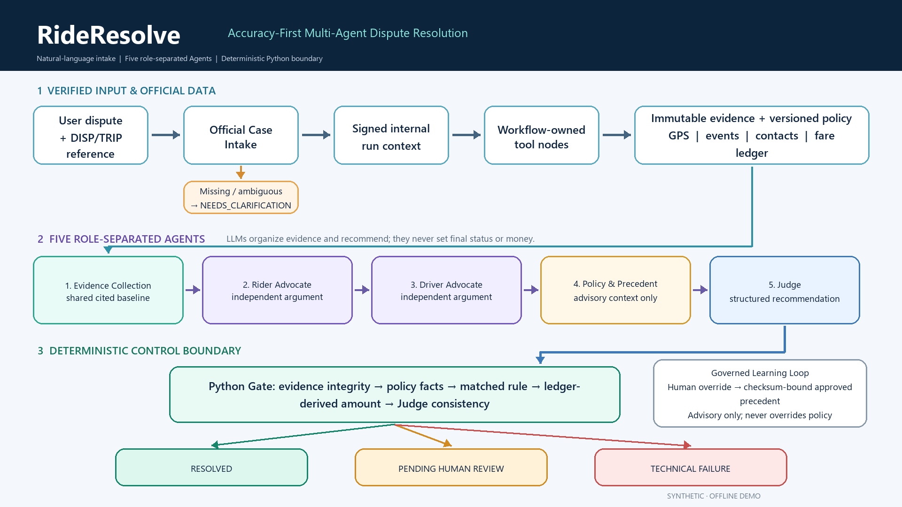
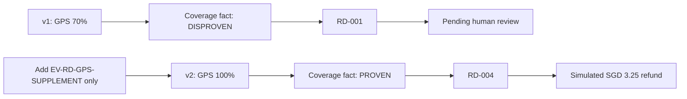

# RideResolve architecture

```mermaid
flowchart LR
    U["User problem description"] --> IN["Official Case Intake"]
    IN -->|"exact DISP/TRIP reference"| RC["Signed internal run context"]
    IN -->|"missing or ambiguous reference"| CL["Needs clarification"]
    RC --> WT["Explicit role-scoped workflow tool nodes"]
    WT --> D["Official immutable evidence + versioned policy"]
    D --> EC["Evidence Collection Agent"]
    EC --> RA["Rider Advocate"]
    EC --> DA["Driver Advocate"]
    RA --> J["Judge recommendation"]
    DA --> J
    PP["Policy & Precedent Agent"] --> J

    HR["Human reviewer override"] --> LF["Learning Feedback Loop"]
    LF --> KB["Approved append-only precedent memory"]
    KB --> PP

    D --> RA
    D --> DA
    D --> PP

    J --> G["Python deterministic boundary"]
    D --> G
    G --> I["Evidence integrity and input fingerprint"]
    I --> P["Policy facts and rule evaluation"]
    P --> A["Allowed action + ledger-derived amount"]
    A --> C["Judge consistency check"]
    C --> E["Escalation Protocol"]
    E --> S["Resolved / Pending review / Technical failure"]
    S --> UI["Streamlit explanation and Decision Delta"]
```

## Responsibility boundary

| Layer | May do | Must not do |
|---|---|---|
| Official Case Intake | accept a natural-language problem description, resolve an explicit official `DISP-*` or `TRIP-*` reference, create a signed internal run context | guess a case by semantic similarity, expose connector credentials, or treat legacy mock data as authoritative |
| Workflow tool nodes | execute fixed role-scoped requests, hold masked credentials, expose audited outputs | use model-generated parameters, decide outcomes, leak credentials to Agents |
| Evidence collector | verify returned records, package a shared evidence baseline, report gaps | call tools, decide credibility, liability, status, action, or money |
| ADP advocates | select relevant supplied evidence and build cited arguments | call tools, invent evidence, execute money movement, set final status |
| Policy & Precedent Agent | validate supplied policy and approved corrections, provide cited advisory context | call tools, copy historical outcomes, edit policy, determine status/action/money |
| ADP Judge | compare both arguments and recommend a policy action | bypass Python gates, claim a real refund, silently repair missing evidence |
| Learning feedback loop | validate genuine human overrides and publish checksum-bound advisory records | learn from unapproved notes, retrain automatically, mutate policy silently |
| Python | validate evidence, evaluate policy, derive money/status, bind Delta inputs | present a technical model failure as a difficult business dispute |
| Escalation protocol | route blocked or low-confidence cases with a complete review packet | use confidence to approve a case or override a deterministic gate |
| Streamlit | explain evidence, roles, gates, result, notifications, and Delta | relabel synthetic records as replay/live or imply a real platform action |

Chat semantics and historical behavior profiles sit on the explanatory side of this boundary. They may help an Advocate organize a case, but Python policy evaluators do not consume them for credibility, liability, final status, or amount.

## Public input boundary

The public v0.6 entry point is `SYS.UserQuery`, not `run_id`. A user describes the dispute in normal language and includes an official case or trip reference. The Intake tool resolves that explicit reference against the official dataset and creates the internal run only after a unique match. `run_id` and the signed `run_context` are internal correlation and authorization fields; they are never required from the end user. If an official reference is absent, unknown, or ambiguous, the workflow returns `NEEDS_CLARIFICATION` instead of guessing. When official and legacy mock data conflict, official data wins.

The Evidence Collection Agent, Policy & Precedent Agent, Learning Feedback Loop, and Escalation
Protocol are executable in the local synthetic demo. The canonical v0.6 ADP design has one
natural-language Intake operation followed by five strictly sequential Agents: Evidence
Collection, Rider Advocate, Driver Advocate, Policy & Precedent, and Judge. All five Agents are
tool-free; role-scoped workflow nodes call the deployed CloudBase API. The preserved cloud runs
are historical evidence only and must not be presented as proof that the v0.6 Intake deployment
or WorkBuddy integration has completed.

## Main Decision Delta path

The second diagram is a deterministic statement about the fixed synthetic fixtures and `DEMO_POLICY_V1`; it is not a claim of real-world causal fairness.
